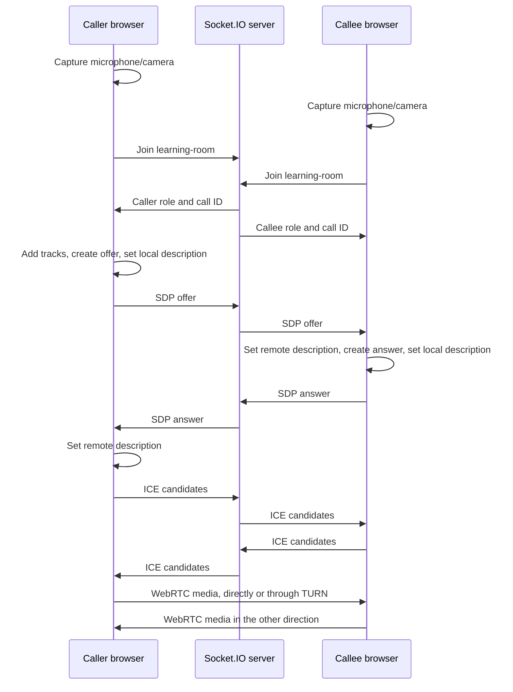

# Learn the technology by reading this demo

## The goal

You should be able to explain how the other browser receives your microphone and camera without saying only “a library handles it.” This project exposes the native WebRTC steps while keeping the room and interface small.

Start with README.md and make a call. Then read the modules below in order. Numbered comments `[1]` through `[8]` in `CallController.js` correspond to this guide.

## 1. Five concepts before the code

| Term | Plain explanation | Where it appears |
| --- | --- | --- |
| MediaStream | A collection of media tracks | Local/remote preview |
| MediaStreamTrack | One audio or video source | `stream.getTracks()` |
| Signaling | Your application exchanging setup messages | Socket.IO |
| SDP | Text describing media, codecs and transport parameters; not the video itself | Offer/answer |
| ICE candidate | A possible network path; not proof that it works | Candidate messages |

`RTCPeerConnection` coordinates media transport, negotiation and connectivity. Your application provides signaling: this demo uses Socket.IO. A Socket.IO room is just a server-side group of connections, not an audio/video mixing room.

**STUN** helps discover network address mappings. **TURN** relays media when an appropriate direct path cannot be established. The Node signaling server and the TURN server have different jobs. This project does not secretly turn the Node server into a media relay.

## 2. The complete call flow



SDP and ICE events may overlap; the diagram is a conceptual order, not a promise that every network message arrives in that exact sequence. We deliberately buffer early candidates.

## 3. Read the shared event names

Open `shared/protocol.js`. `ROOM_ID` is the hardcoded room name. Both browser and server import the same constants so an event typo cannot create two separate protocols.

| Event | Direction | Meaning |
| --- | --- | --- |
| `room:join` | Browser → server | Request room membership |
| `room:state` | Server → member | Role, occupancy and current call ID |
| `rtc:description` | Browser → server → other browser | Offer or answer |
| `rtc:candidate` | Browser → server → other browser | Candidate network path |
| `call:end` | Browser → server | End this call round |
| `call:ended` | Server → both members | Release the peer connections |
| `room:leave` | Browser → server | Release room membership |
| `room:peer-left` | Server → remaining member | Release the old media connection |

These are application-defined strings. The browser has no built-in `room:join` WebRTC method.

## 4. Understand the server

Read `server/createServer.js`.

The `members` Map is the application room registry. The first socket in insertion order gets the caller role; the second gets the callee role. A third join is rejected. Calling Join repeatedly does not consume extra slots.

When a second member joins, the server makes a fresh `callId` using `randomUUID()`. Every SDP and ICE payload includes that ID. The server validates membership, ID and message shape before forwarding to the other member.

`socket.to(ROOM_ID).emit(...)` excludes the sender. The server forwards the SDP/ICE payload; it does not generate either description or inspect camera frames.

The server restricts offers to the caller and answers to the callee. This removes simultaneous-offer collisions from this first lesson. These roles are not the “polite/impolite” roles used by the advanced perfect-negotiation pattern.

### Why the call ID matters

Imagine ending call 1 and starting call 2. An ICE callback from call 1 might finish late. Without a session identifier, the application could apply it to call 2. Here the server rotates the ID after hang-up and rejects old messages. The client checks the ID too.

The call ID is not a password or authentication system. This is a single public demo room intended for a controlled learning environment.

### Why no database?

Room membership and active call state are temporary. A single process and Map are enough for this exercise. A future application may store users, room access rules and call history in a database, but saving SDP blobs in MongoDB does not establish a media connection.

`server/index.js` reads optional environment settings and starts the exported server factory. `createServer.js` stays importable so tests can run isolated copies on random ports.

## 5. [1] Open the camera and microphone

Read `startCamera()`.

```js
const stream = await navigator.mediaDevices.getUserMedia({
  audio: true,
  video: { width: { ideal: 640 }, height: { ideal: 360 } }
})
```

This requests permission and returns a MediaStream. It does not create a call. `ideal` dimensions are preferences, not strict requirements.

`VideoPanel` assigns the stream to the video element's **srcObject**, not its `src` URL. The local element is muted so your own microphone is not played through your speakers. Muting this HTML element does not mute what you send to the remote peer.

`mediaRequest` distinguishes a current permission request from an abandoned one. If you click Leave while the browser prompt is pending, a late successful result must have its tracks stopped immediately.

Both camera and microphone are requested in this version. Missing either device can reject the request. An audio-only option is an exercise below.

## 6. [2] Join the room

Read `joinRoom()` and `receiveRoomState()`.

Joining requires a local stream and a connected signaling socket. The client sends a join request and waits for a server acknowledgement. The acknowledgement can contain success or a readable error such as “room is full.”

The server also sends updated room state to the other member. Once both are present, the caller sees an enabled Start call button. The callee waits for an offer.

A room join does not imply media is connected. Notice the separate UI fields for signaling, room role and peer connection.

Socket IDs are transient connection identifiers, not permanent user IDs. The demo uses them to address current sockets and explicitly requires a manual room rejoin after signaling loss. An authenticated application would need a separate identity model.

## 7. [3] Create the peer connection

Read `createPeer()`.

1. Fetch STUN/TURN configuration from `/api/ice-servers`.
2. Check that the user has not left while the fetch was pending.
3. Create `RTCPeerConnection`.
4. Register ICE, track and state listeners.
5. Add each existing local track with `pc.addTrack(track, localStream)`.

Adding tracks tells the peer connection which media to send. Calling `createOffer()` before adding tracks would describe a different initial media layout.

A `session` object owns the PC, call ID and remote stream. Callbacks check `current(session)` before updating the UI. Closing a session clears ownership first so late events from that PC cannot masquerade as the replacement call.

The local capture stream remains separate because Hang up should allow another call without another permission request.

## 8. [4] The caller creates an offer

Read `startCall()`.

```js
const offer = await pc.createOffer()
await pc.setLocalDescription(offer)
// Send pc.localDescription to the other browser through your signaling server.
```

`createOffer()` creates a proposal. `setLocalDescription()` applies it locally and starts the appropriate negotiation/gathering work. Only after that do we send the description.

The demo sends `{ type, sdp }` through Socket.IO. It never sends a JavaScript RTCPeerConnection object to the other machine. Each browser constructs its own peer connection.

After setting an offer, the signaling state commonly becomes `have-local-offer` until the answer is applied. This SDP state is different from ICE state and connection state.

## 9. [5] The callee answers

Read `receiveDescription()`.

The callee receives an offer, creates its own peer connection and applies the offer:

```js
await pc.setRemoteDescription(offer)
const answer = await pc.createAnswer()
await pc.setLocalDescription(answer)
```

It sends the answer back. The caller applies that answer with `setRemoteDescription(answer)`.

All these operations are asynchronous. Skipping `await` can cause later operations to run against the wrong signaling state. The incoming signal queue is a chain of promises that preserves application processing order while descriptions are being applied.

We check session ownership again after asynchronous operations. A user can leave between starting and completing an operation.

## 10. [6] Exchange ICE candidates

Read the `onicecandidate` callback, `receiveCandidate()` and `flushCandidates()`.

The browser discovers possible network paths and produces candidates. We send each candidate as it appears: this is trickle ICE. The other peer calls `addIceCandidate()`.

A candidate can arrive before the receiver has applied the matching remote description. The client queues such candidates and flushes them after `setRemoteDescription()` succeeds. Queues are bounded and cleared when a call ends.

We log candidate types, not full candidate addresses. A host candidate does not prove connectivity; a relay candidate does not prove relayed packets are flowing. The browser still tests and selects paths.

The `connectionstatechange` listener updates the UI. `ontrack` means a remote track has been associated; it may fire before actual media packets decode. To inspect actual receipt in development:

```js
await window.__rtcDemo.snapshot()
```

The dev-only snapshot includes inbound packet bytes and decoded video-frame counts. The browser tests check these instead of only trusting the word “connected.”

## 11. Microphone and camera controls

Read `toggleMicrophone()` and `toggleCamera()`.

```js
audioTrack.enabled = false
videoTrack.enabled = false
```

These temporarily disable the track's content. They do not stop the track permanently. Sending a message saying “muted” would only update UI; it would not mute the actual source.

`track.stop()` ends that track. You cannot turn an ended track back on using `enabled = true`; acquire a new track instead. Browser/device indicators and hardware sharing behavior can differ, so use the explicit Leave button when you want this app to stop its capture tracks.

## 12. [7] Hang up versus [8] Leave

| Action | Peer connection | Room membership | Local capture |
| --- | --- | --- | --- |
| Hang up | Closed | Kept | Kept for preview and next call |
| Peer leaves | Closed | Remaining member stays | Kept for preview |
| Leave / stop camera | Closed | Released | Stopped |
| Signaling disconnects | Closed | Must rejoin after reconnect | Kept until user stops it |
| Component unmount | Closed | Released/disconnected | Stopped |

`closePeer()` removes event handlers, closes the PC, clears pending ICE, ends received tracks and clears remote video. `leaveRoom()` additionally stops local tracks and resets room state.

`revision`, `mediaRequest`, `joinRequest` and `callRequest` are small cancellation guards. They prevent a previous operation's eventual completion from acting on a replacement session. They are not an automatic reconnect system.

## 13. Understand the React boundary

`CallController` owns imperative browser/network objects. `useCall()` creates it inside an effect and disposes it during cleanup. The component consumes state snapshots and invokes named actions.

If a peer connection were constructed directly in the component body, every render could create more connections. If listeners were added repeatedly without removal, one received offer could be processed several times.

React StrictMode remains enabled. Its development setup/cleanup cycle exercises ownership. Brief initial signaling connects/disconnects during that cycle are not extra room participants.

`App.jsx` is intentionally small. The video component handles browser playback policy: if autoplay is blocked, the remote panel offers a user-gesture playback button.

## 14. Local proxy and ports

The browser connects to the page's own origin. `vite.config.js` forwards `/socket.io` and `/api` to port 3001. WebSocket proxying is enabled.

This avoids teaching CORS and multiple public backend URLs before the call works. It also keeps an HTTPS frontend's signaling on the same HTTPS origin when a properly configured reverse proxy/tunnel is used.

`vite build` builds only the frontend. A deployed app still needs signaling and path routing. `vite preview` inherits the configured proxy for a local build check; run the Node server alongside it.

## 15. Exercises: change one thing at a time

1. **Audio only:** add an explicit audio-only choice before capture. Request `video: false`, adapt the preview/status UI, and test an audio-only call in both directions.
2. **Read SDP:** use a temporary development breakpoint to inspect `localDescription`. Find media sections, codec entries and ICE parameters. Do not assume the text is media content.
3. **Change resolution:** request an ideal 1280×720 video capture. Inspect the actual track settings and remote decoded size.
4. **Early candidates:** deliberately delay applying an offer. Confirm that queued candidates are later flushed successfully.
5. **Repeated calls:** hang up and call again five times. Verify that only current tracks remain and new call IDs are used.
6. **TURN:** configure your TURN server and force `relay`. Then break the credentials and observe how setup fails. Restore the settings afterward.
7. **Manual recovery:** stop the Node server during a call, restart it, rejoin both tabs and make another call. Understand the documented cleanup behavior before adding automatic recovery.
8. **Screen sharing:** replace the outgoing video track using a same-kind screen track where supported, and restore the camera when sharing ends. Handle cases requiring renegotiation as a separate lesson.
9. **Perfect negotiation:** remove fixed offerer assumptions only after implementing polite/impolite collision handling and updating server role validation together.
10. **Named rooms:** replace the constant with a validated room ID and a per-room registry. Add access control before exposing real user sessions publicly.

## References

- WebRTC peer connections: https://webrtc.org/getting-started/peer-connections
- Small runnable API samples: https://webrtc.github.io/samples/
- getUserMedia: https://developer.mozilla.org/en-US/docs/Web/API/MediaDevices/getUserMedia
- Signaling and video calling: https://developer.mozilla.org/en-US/docs/Web/API/WebRTC_API/Signaling_and_video_calling
- Perfect negotiation (later lesson): https://developer.mozilla.org/en-US/docs/Web/API/WebRTC_API/Perfect_negotiation
- Socket.IO rooms: https://socket.io/docs/v4/rooms/
- Socket.IO connection identity: https://socket.io/docs/v4/server-socket-instance/
- Vite configuration: https://vite.dev/config/
